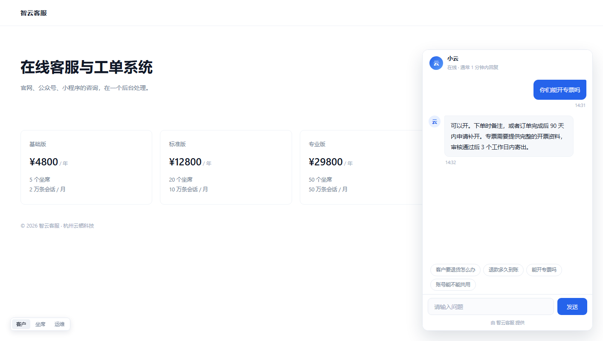
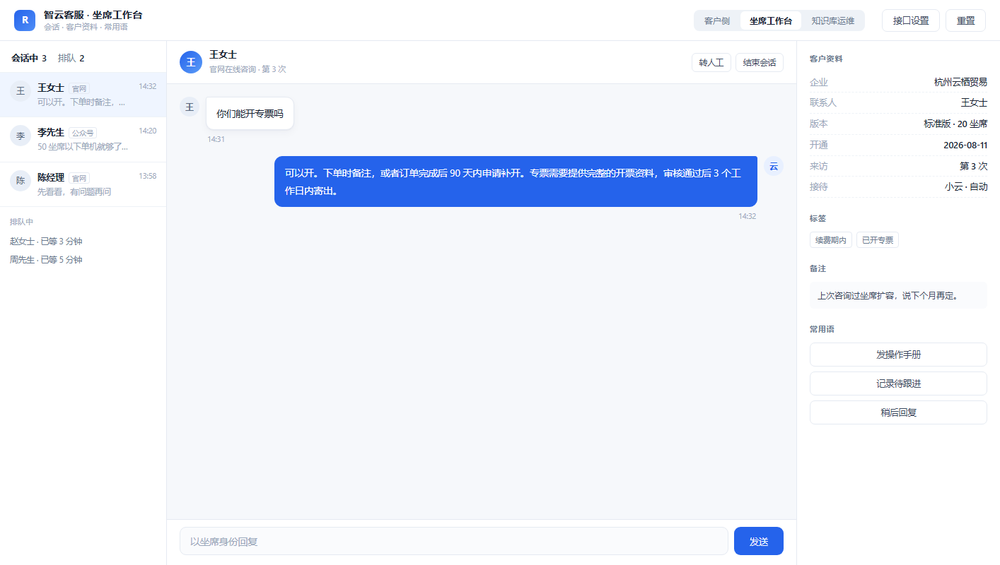
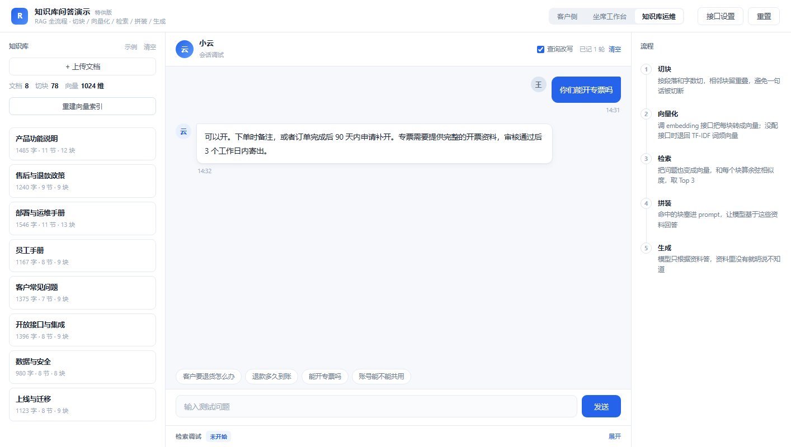

# 智云客服 · RAG 问答演示

智云客服是一套面向售前售后条款问答的 RAG 客服演示，提供客户咨询、坐席接待与检索调试三个视角，支持口语提问、多轮追问，并从 8 份业务文档中检索条款、生成客服口吻的整条回复。

[演示页面](rag-demo.html) · [评测报告](docs/评测报告.md) · [知识库样例](知识库样例/01-产品功能说明.md) · [本地代理](sensenova-proxy.py)







## 快速开始

演示页面为单文件 HTML，打开 `rag-demo.html` 即可查看三个视角界面。

完整问答需要本地代理与模型接口：

```bat
start-proxy.bat
```

保持窗口运行，在页面「接口设置」中填写对话模型与向量模型的地址和 Key。对话地址填 `http://127.0.0.1:8890/v1`。仅查看界面可跳过这一步；接口留空时页面使用 TF-IDF 本地检索，回复为资料原文摘录。

| 项目 | 要求 |
| --- | --- |
| 浏览器 | Chrome |
| 页面运行 | Python 3（本地代理） |
| 评测脚本 | Node 18+ |

## 功能特性

- **客户咨询**：官网客服挂件，支持快捷提问、多轮追问，等待期间显示输入状态。
- **坐席接待**：会话列表、排队接入、客户资料，可在同一窗口以坐席身份发言。
- **检索调试**：查看切块、命中块、相似度、查询改写与拼装后的提示词。
- **RAG 问答**：意图路由、查询改写、双路检索、证据判定、补关键词重查与整条回复生成。
- **统一知识库**：三个视角共用 8 份业务文档、78 个切块。技术信息集中在检索调试视角。

## 技术栈

- 前端：单文件 HTML，内联 CSS 与 JavaScript。
- 对话模型：商汤 `sensenova-6.8-flash-lite`，主模型失败时切换备用模型。
- 向量模型：`BAAI/bge-m3`，1024 维；向量缓存按文档签名失效，存于浏览器 `localStorage`。
- 本地代理：Python 标准库 `http.server`，转发带 `Authorization` 的请求并补 CORS 响应头。

问答链路：意图路由（寒暄、身份、转人工走规则）→ 查询改写 → 双路检索 → 证据判定 → 资料不足时补关键词重查再判定 → 拼提示词 → 对话模型生成 → 整条送达。

知识库按 Markdown 标题分小节，节内按句累加到 220 字一块、重叠 40 字。检索采用 TF-IDF 与向量双路；改写句与原句各检索一次，改写句 Top1 高出原句 3 个百分点才采用。证据判定由模型输出可用块编号，判定为资料不足时补关键词重查一次。

## 评测结果

`eval/评测集.jsonl` 共 23 条标注题，覆盖条款问答、多轮追问、无答案与越权场景，其中 20 条有标注答案，3 条为无答案或越权题。检索侧调用页面的 `rank(q)`，生成侧端到端调用 `run()`。评测在本机离线环境完成，知识库为虚构样例；逐题回复、命中块与耗时见 [评测报告](docs/评测报告.md)。

| 指标 | 结果 | 样本 | 测量方式 |
| --- | --- | --- | --- |
| Hit@1 | 16 / 20 = 80.0% | 20 条 | Top1 命中标注文档与小节 |
| Hit@3 / Hit@5 | 18 / 20 = 90.0% | 20 条 | 前 3 / 5 块中至少一块命中 |
| 文档命中@1 | 18 / 20 = 90.0% | 20 条 | Top1 只比对文档标题 |
| MRR | 0.842 | 20 条 | 首个正确结果排名的倒数平均 |
| 平均要点覆盖率 | 81.8%，全覆盖 8 / 11 | 11 条 | 标注关键词出现在回复中 |
| 拒答 / 不编造 | 2 / 3 | 3 条 | 规则判定 |
| 端到端延迟 | 平均 21.8 秒，P50 20.2 秒，P95 34.3 秒 | 14 题 | 12.7 至 40.7 秒 |
| 调用失败 | 0 / 14 | 14 题 | 请求报错或界面未完成回复 |

运行评测：

```
node eval/评测脚本.js <临时目录> <页面副本.html> eval/评测结果.json
python eval/生成报告.py
node scripts/截图.js <临时目录> <页面副本.html> docs/images
```

## 已知限制

- 多轮省略追问存在误命中：连续提问时，追问句可能命中其他主题的小节。逐题数据见评测报告。
- 业务问题端到端延迟 12.7 至 40.7 秒，链路各步骤串行执行。
- 知识库正文内嵌于页面 HTML，与 `知识库样例/` 的 Markdown 文件相互独立，修改后需重新生成内嵌数据。
- 当前范围为条款问答演示；工单流转、登录鉴权与业务系统对接在范围之外。

## 目录结构

```
rag-kefu-demo/
├── README.md              项目说明
├── rag-demo.html          演示页面，HTML / CSS / JS 全部内联
├── sensenova-proxy.py     本地转发代理
├── start-proxy.bat        代理启动脚本
├── 知识库样例/            8 份业务文档 Markdown 原件
├── docs/
│   ├── 评测报告.md         指标、逐题结果与未达标样例
│   └── images/            三视角界面图
├── eval/
│   ├── 评测集.jsonl        23 条标注题
│   ├── 评测结果.json       逐题原始数据
│   ├── 评测脚本.js         检索侧与生成侧评测
│   └── 生成报告.py         由结果生成报告
└── scripts/
    └── 截图.js            生成三视角界面图
```
